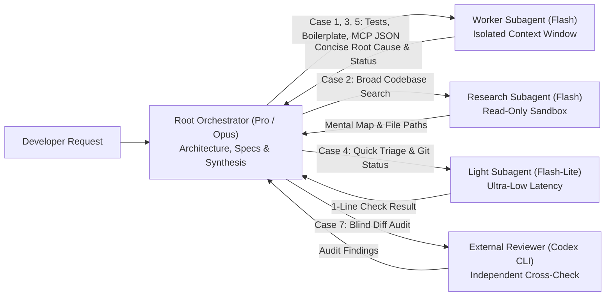

# Smart Model Routing (`smr`)

[](https://www.python.org/downloads/)
[-brightgreen.svg)](pyproject.toml)
[](pyproject.toml)
[](#compatibility)

**Stop burning frontier model tokens on test logs, grep dumps, and MCP JSON payloads.**

`smr` is a zero-dependency, cross-platform Python CLI and rule architecture that enforces **Root Context Shielding** across AI coding harnesses. Your frontier model (`Pro` / `Opus` / `inherit`) stays focused on architecture, trade-offs, and synthesis—while high-volume I/O, broad codebase scans, test suites, boilerplate edits, and blind diff reviews are offloaded to fast subagents and peer reviewers.

> [Leia em Português (PT-BR)](README.pt-BR.md)

---

## Why Root Context Shielding Matters

Every turn in an AI coding session **re-sends the entire conversation history** to the model. When you run a test suite, grep 40 files, or fetch a 15k-token MCP JSON payload directly inside the main conversation, those raw tokens don't just cost money once—they **compound quadratically** on every subsequent turn and degrade reasoning ("context rot").



---

## The 7 Operational Cases Matrix

| Case | Workload Type | Target / Tier | Directive |
| :---: | :--- | :--- | :--- |
| **1** | Static validation, linting, tests & builds | `self` (`flash`) | Isolate verbose stdout/stderr; return only pass/fail, pinpoint errors & root cause. |
| **2** | Codebase exploration, broad grep & multi-file research | `research` (`flash`) | Explore in read-only sandbox; return mental map & exact file locations. |
| **3** | Mechanical implementation, boilerplate & repetitive edits | `self` (`flash`) | Orchestrator defines contracts & interfaces; worker implements & validates. |
| **4** | Quick triage & single-file / `git status` checks | `self` (`flash_lite`) | Ultra-fast, low-cost check without polluting root conversation history. |
| **5** | External MCP integrations & heavy JSON/API payloads | `self` (`flash`) | Parse and filter bulky external payloads in subagent before reporting summary. |
| **6** | Architecture, planning, specs & trade-off decisions | **Root** (`pro` / `inherit`) | Drive user alignment, system design, OpenSpec contracts & final synthesis. |
| **7** | Blind code review, diff audit & cross-validation | **External** (`codex review`) | Independent diff audit before commits & active quota diversification. |

---

## Quick Start

Requires **Python 3.10+** and zero external packages.

```bash
# Clone the repository
git clone https://github.com/LimaNathan/smart-model-routing.git
cd smart-model-routing

# Install globally across detected harnesses + worktree agent spec
python bin/smr.py install --scope global --with-worktree-agent

# Or install into a specific project (with CONTEXT_HANDOFF.md continuity doc)
python bin/smr.py install --scope project --project-dir /path/to/repo --with-handoff

# Or install as an editable CLI tool
pip install -e . --no-build-isolation
smr doctor
```

### Safe, Non-Destructive & Idempotent

- Uses explicit HTML markers: `<!-- SMART-MODEL-ROUTING:START -->` and `<!-- SMART-MODEL-ROUTING:END -->`.
- Creates an automatic `<filename>.bak` backup before modifying any existing file.
- Preserves all personal rules and memories above and below the markers.
- Re-running `smr install` updates **only** the marked block in-place (zero duplication).
- Writes atomically via `tempfile.NamedTemporaryFile` + `os.replace`.

---

## CLI Commands

### `smr install`

```bash
python bin/smr.py install [OPTIONS]
```

| Flag | Default | Description |
| :--- | :--- | :--- |
| `--target` | `all` (project) / auto-detect (global) | `antigravity`, `claude`, `codex`, `cursor`, or `all` |
| `--scope` | `project` | `global` (under home dir) or `project` (repo root) |
| `--lang` | `en` | Rule template language: `en` or `pt-br` |
| `--project-dir` | Current directory | Target project directory for `--scope project` |
| `--home-dir` | User home | Override home directory (ideal for isolated tests) |
| `--with-handoff` | `false` | Create `docs/CONTEXT_HANDOFF.md` if it does not exist |
| `--with-worktree-agent` | `false` | Install `worktree-agent.md` in `.gemini/agents/`, `.claude/agents/`, `.agents/agents/` |
| `--dry-run` | `false` | Preview operations without touching the filesystem |

### `smr uninstall`

Surgically removes only the `<!-- SMART-MODEL-ROUTING:START --> ... <!-- SMART-MODEL-ROUTING:END -->` block while keeping all user memories intact:

```bash
python bin/smr.py uninstall --scope global
```

### `smr doctor`

Audits your local setup:
1. Detects installed harness directories (`~/.gemini`, `~/.claude`, `~/.codex`, `~/.agents`, `~/.cursor`) and CLI binaries (`git`, `codex`, `claude`, `agy`, `cursor`, `python`).
2. Verifies whether Smart Model Routing rules are active globally and in the current project.
3. Scans rule files for accidental leaks or portability issues (RFC1918 private IPs, `sk-`/`ghp_`/`glpat-` tokens, hardcoded `C:\Users\...` or `/Users/...` paths) and prints redacted warnings.

```bash
python bin/smr.py doctor
```

### `smr benchmark`

Simulates a realistic 15-turn engineering session (2 planning turns, 3 broad codebase searches, 4 verbose test/build runs, 2 MCP JSON fetches, 3 boilerplate edits, 1 diff code review) comparing **Monolithic Single-Agent** vs **Smart Model Routing**:

```text
Smart Model Routing — 15-Turn Root Context Shielding Benchmark
Scenario: 2 planning, 3 broad searches, 4 test/build logs, 2 MCP JSONs, 3 boilerplate edits, 1 diff review

Key Metrics:
  Monolithic Cumulative Root Input Tokens : 1,219,500
  Routed Cumulative Root Input Tokens     : 318,010
  Root Frontier Token Savings             : 73.9%
  Final Peak Root Context (Turn 15)       : 154,750 -> 30,540 (-80.3%)
  Offloaded Subagent Tokens (Flash/Codex) : 138,050
  Illustrative Input Cost (@$3/1M vs $0.15/1M): $3.66 -> $0.97
```

Run `python bin/smr.py benchmark --format markdown` for a Markdown table ready to paste into RFCs or PRs.

---

## Compatibility

| Harness | Project Scope Target | Global Scope Target |
| :--- | :--- | :--- |
| **Google Antigravity** | `./GEMINI.md` | `~/.gemini/GEMINI.md` |
| **Claude Code** | `./CLAUDE.md` | `~/.claude/CLAUDE.md` |
| **OpenAI Codex CLI** | `./AGENTS.md` | `~/.codex/AGENTS.md` |
| **Cursor** | `./.cursorrules` | `~/.cursor/rules/smart-model-routing.mdc` |

---

## Running Tests

```bash
python -m unittest discover -s tests -v
```
