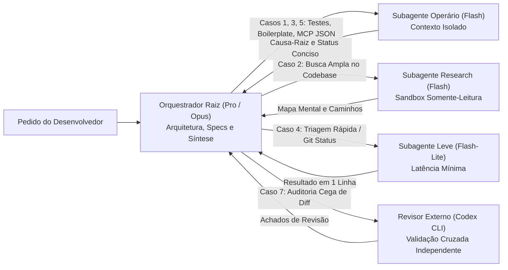

# Smart Model Routing (`smr`)

[](https://www.python.org/downloads/)
[-brightgreen.svg)](pyproject.toml)
[](pyproject.toml)
[](#compatibilidade)

**Pare de queimar tokens de modelos frontier em logs de teste, dumps de grep e payloads JSON de MCP.**

`smr` é um CLI zero-dependency em Python stdlib e uma arquitetura de regras para **Blindagem do Contexto Raiz (Root Context Shielding)** em múltiplos harnesses de código com IA. Seu modelo principal (`Pro` / `Opus` / `inherit`) foca exclusivamente em arquitetura, trade-offs e síntese — enquanto I/O pesado, varreduras no codebase, suítes de teste, boilerplate e auditoria cega de diffs são delegados para subagentes rápidos e revisores independentes.

> [Read in English](README.md)

---

## Por Que Blindar o Contexto Raiz?

A cada turno de conversa com um agente de código, **todo o histórico acumulado é reenviado** ao modelo. Quando você executa uma suíte de testes, faz um grep amplo ou lê um JSON gigante de MCP diretamente no chat principal, esses tokens não custam caro só naquele turno — eles **crescem quadraticamente** em todos os turnos seguintes e degradam o raciocínio do modelo (*context rot*).



---

## A Matriz de 7 Casos Operacionais

| Caso | Tipo de Carga de Trabalho | Destino / Tier | Diretriz |
| :---: | :--- | :--- | :--- |
| **1** | Validação estática, linting, testes e builds | `self` (`flash`) | Isolar stdout/stderr verbosos; retornar apenas status, erros pontuais e causa-raiz. |
| **2** | Exploração, busca ampla e pesquisa em múltiplos arquivos | `research` (`flash`) | Explorar em sandbox somente-leitura; devolver mapa mental e caminhos exatos. |
| **3** | Implementação mecânica, boilerplate e edições repetitivas | `self` (`flash`) | Orquestrador define contratos e interfaces; operário implementa e valida. |
| **4** | Triagens rápidas e checagens pontuais (`git status`, arquivo único) | `self` (`flash_lite`) | Execução ultra-rápida e barata sem poluir o histórico principal. |
| **5** | Integrações MCP e APIs externas com JSON volumoso | `self` (`flash`) | Filtrar payloads externos pesados no subagente antes de reportar o resumo. |
| **6** | Arquitetura, planejamento, specs e decisões de design | **Raiz** (`pro` / `inherit`) | Conduzir alinhamento com o usuário, design de sistema e síntese final. |
| **7** | Code review cego, auditoria de diffs e validação cruzada | **Externo** (`codex review`) | Auditoria independente antes de commits finais e diversificação ativa de cotas. |

---

## Início Rápido

Requer apenas **Python 3.10+** (zero dependências externas).

```bash
# Clone o repositório
git clone https://github.com/LimaNathan/smart-model-routing.git
cd smart-model-routing

# Instale globalmente nos harnesses detectados + agente de git worktree
python bin/smr.py install --scope global --lang pt-br --with-worktree-agent

# Ou instale em um projeto específico (com doc de continuidade CONTEXT_HANDOFF.md)
python bin/smr.py install --scope project --lang pt-br --project-dir /caminho/do/repo --with-handoff

# Ou instale como comando CLI editável
pip install -e . --no-build-isolation
smr doctor
```

### Instalação Segura, Não-Destrutiva e Idempotente

- Utiliza marcadores explícitos: `<!-- SMART-MODEL-ROUTING:START -->` e `<!-- SMART-MODEL-ROUTING:END -->`.
- Cria backup automático `<arquivo>.bak` antes de modificar qualquer arquivo existente.
- Preserva 100% das suas memórias e regras pessoais acima e abaixo dos marcadores.
- Rodar `smr install` novamente atualiza **apenas** o trecho entre marcadores, sem duplicação.
- Escrita atômica com `tempfile.NamedTemporaryFile` + `os.replace`.

---

## Comandos do CLI

### `smr install`

```bash
python bin/smr.py install [OPÇÕES]
```

| Flag | Padrão | Descrição |
| :--- | :--- | :--- |
| `--target` | `all` (projeto) / auto-detecção (global) | `antigravity`, `claude`, `codex`, `cursor` ou `all` |
| `--scope` | `project` | `global` (no diretório home) ou `project` (na raiz do repo) |
| `--lang` | `en` | Idioma do template de regras: `en` ou `pt-br` |
| `--project-dir` | Diretório atual | Caminho do projeto alvo para `--scope project` |
| `--home-dir` | Home do usuário | Override de home (essencial para testes seguros isolados) |
| `--with-handoff` | `false` | Cria `docs/CONTEXT_HANDOFF.md` no projeto se ainda não existir |
| `--with-worktree-agent` | `false` | Instala `worktree-agent.md` em `.gemini/agents/`, `.claude/agents/` e `.agents/agents/` |
| `--dry-run` | `false` | Simula as alterações sem gravar arquivos em disco |

### `smr uninstall`

Remove cirurgicamente apenas o bloco `<!-- SMART-MODEL-ROUTING:START --> ... <!-- SMART-MODEL-ROUTING:END -->`, preservando todo o restante das suas memórias:

```bash
python bin/smr.py uninstall --scope global
```

### `smr doctor`

Diagnostica o ambiente do desenvolvedor:
1. Detecta diretórios de harnesses (`~/.gemini`, `~/.claude`, `~/.codex`, `~/.agents`, `~/.cursor`) e binários no PATH (`git`, `codex`, `claude`, `agy`, `cursor`, `python`).
2. Verifica se o bloco `SMART-MODEL-ROUTING` está ativo globalmente e no projeto atual.
3. Executa um scanner rápido de sanitização nos arquivos de regras para alertar (sem expor valores) sobre IPs privados RFC1918, tokens (`sk-`, `ghp_`, `glpat-`, `AIza`, `AKIA`) ou caminhos absolutos acoplados a uma máquina específica.

```bash
python bin/smr.py doctor
```

### `smr benchmark`

Simula uma sessão típica de 15 turnos (2 turnos de planejamento, 3 buscas amplas no codebase, 4 execuções verbosas de testes/builds, 2 chamadas MCP JSON, 3 edições de boilerplate e 1 code review de diff) comparando **Agente Monolítico** vs **Smart Model Routing**:

```text
Smart Model Routing — 15-Turn Root Context Shielding Benchmark
Scenario: 2 planning, 3 broad searches, 4 test/build logs, 2 MCP JSONs, 3 boilerplate edits, 1 diff review

Key Metrics:
  Monolithic Cumulative Root Input Tokens : 1,219,500
  Routed Cumulative Root Input Tokens     : 318,010
  Root Frontier Token Savings             : 73.9%
  Final Peak Root Context (Turn 15)       : 154,750 -> 30,540 (-80.3%)
  Offloaded Subagent Tokens (Flash/Codex) : 138,050
  Illustrative Input Cost (@$3/1M vs $0.15/1M): $3.66 -> $0.97
```

Use `python bin/smr.py benchmark --format markdown` para gerar a tabela completa em Markdown.

---

## Compatibilidade

| Harness | Arquivo no Escopo `project` | Arquivo no Escopo `global` |
| :--- | :--- | :--- |
| **Google Antigravity** | `./GEMINI.md` | `~/.gemini/GEMINI.md` |
| **Claude Code** | `./CLAUDE.md` | `~/.claude/CLAUDE.md` |
| **OpenAI Codex CLI** | `./AGENTS.md` | `~/.codex/AGENTS.md` |
| **Cursor** | `./.cursorrules` | `~/.cursor/rules/smart-model-routing.mdc` |

---

## Executando os Testes

```bash
python -m unittest discover -s tests -v
```
