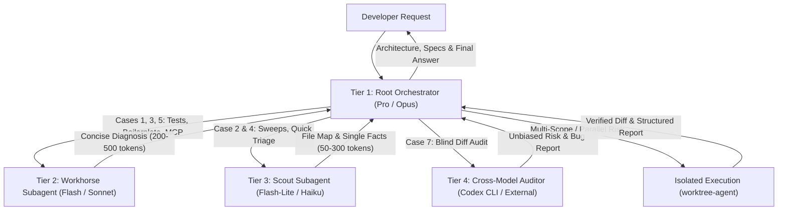

# Smart Model Routing Playbook

**Root Context Shielding, 4-Tier Model Economics, and Multi-Harness Orchestration for AI Coding Agents**

---

## 1. The Problem: Root Context Pollution & Quadratic Token Decay

Most developers treat an AI coding assistant's main conversation as a general-purpose terminal: they run `pytest`, `npm run build`, `git diff`, wide `grep` sweeps, and verbose MCP/API calls directly inside the root thread.

That single habit destroys both **reasoning accuracy** and **token budgets** because of two structural properties of autoregressive LLM sessions:

### 1.1 Every Turn Re-Sends the Entire History

LLM agent harnesses are stateless across HTTP requests. At turn $k$, the provider must process all system instructions, user messages, tool calls, and **tool outputs** from turns $1 \dots k-1$.

Suppose a single unshielded test suite or MCP JSON payload injects **$T_{\text{noise}} = 32{,}000$ tokens** at turn 4 of a 20-turn engineering session:

$$\text{Wasted Input Tokens} = T_{\text{noise}} \times (N - k + 1) = 32{,}000 \times 17 = 544{,}000 \text{ tokens}$$

One noisy command early in a session does not cost 32,000 tokens — it costs **over half a million tokens** re-billed on the most expensive flagship model (`Pro` / `Opus`) across the rest of the conversation.

### 1.2 Attention Dilution ("Lost in the Middle")

Even with 200K–1M token windows, empirical model performance degrades long before the hard limit is hit:

- **Signal-to-Noise Collapse**: 30,000 tokens of passing test lines, stack frames, or OpenAPI JSON schemas drown out the 400 tokens of architectural invariants that actually govern correctness.
- **Premature Compaction**: Once the root window hits compaction thresholds, the harness summarizes older turns, erasing exact function signatures, edge cases, and design constraints you already agreed on.
- **Flagship Quota Exhaustion**: Burning flagship reasoning quotas (`Pro`, `Opus`, `GPT-5/6`) on `git status`, `grep`, or mechanical DTO creation leaves you throttled when you actually need deep architecture reasoning.

---

## 2. The Solution: 4-Tier Routing Architecture

**Smart Model Routing** enforces **Root Context Shielding**: the flagship model acts **strictly as Architect, Orchestrator, and User Interlocutor**, while high-I/O, mechanical, and verification tasks are isolated inside disposable subagent contexts or external cross-model CLIs.



### The Four Tiers Explained

| Tier | Role | Typical Models | What Runs Here | What Returns to Root |
| :--- | :--- | :--- | :--- | :--- |
| **Tier 1: Orchestrator** | Architect & Interlocutor | `Pro`, `Opus`, Flagship Reasoning | System design, specs, trade-offs, task decomposition, final synthesis | User-facing decisions & concise plans |
| **Tier 2: Workhorse** | Builder & Verifier | `Flash`, `Sonnet`, Balanced Coder | Test suites, builds, linters, DTOs, mappers, migrations, MCP JSON absorption | Pass/fail summary, pinpoint failures, changed file list |
| **Tier 3: Scout** | Explorer & Triage | `Flash-Lite`, `Haiku`, `Mini/Nano` | Read-only codebase sweeps, `git status`, config lookups, symbol tracing | File paths, call-site map, single-fact answers |
| **Tier 4: Cross-Auditor** | Blind Reviewer | `Codex CLI`, Separate Provider Family | Pre-commit diff reviews, concurrency/security checks, algorithmic second opinions | Unbiased bug list and edge-case warnings |

---

## 3. Token Economics: Unshielded vs. Root-Shielded Session

Consider a realistic 18-turn feature implementation involving codebase exploration, 4 schema/service files, 3 unit-test runs, 1 linter pass, 1 issue-tracker MCP sync, and a pre-commit review:

| Operation | Unshielded Root Session (Flagship Only) | Root-Shielded Session (Smart Model Routing) | Root Tokens Saved |
| :--- | :--- | :--- | :--- |
| Codebase exploration (12 files + grep) | ~28,000 tokens accumulated in root | ~450 tokens (synthesized file map from `Scout`) | **~98%** |
| Boilerplate implementation + edits | ~18,000 tokens of diffs & file reads | ~600 tokens (contract spec + changed paths) | **~96%** |
| 3 test runs + 1 lint/typecheck run | ~45,000 tokens of raw stdout/tracebacks | ~500 tokens (exact failing lines & pass counts) | **~99%** |
| MCP issue-tracker / Figma JSON fetch | ~22,000 tokens of raw JSON metadata | ~300 tokens (extracted fields & IDs) | **~98%** |
| Quick git/env triage checks (4x) | ~4,000 tokens of command chatter | ~150 tokens (inline facts from `Scout`) | **~96%** |
| **Cumulative Root Context Footprint** | **~125,000+ tokens (triggers compaction)** | **~22,000–35,000 tokens (crisp & focused)** | **~65%–80% overall** |

> **Key Insight**: Subagents still consume cheap `Flash`/`Haiku` tokens inside their own ephemeral windows — and then **discard** 98% of the noise when they close. Your root flagship context stays lean, sharp, and compaction-free from turn 1 to turn 30.

---

## 4. The 7-Case Operational Delegation Guide

Below is the complete playbook for all 7 workload cases, including copy-ready delegation prompt patterns.

### Case 1: Static Validation, Linting, Tests & Builds
- **Target**: `Workhorse` (`self` with `flash` in Antigravity; `Task` with `haiku` in Claude Code; quiet worker in Codex).
- **Why**: Test runners and compilers emit thousands of passing lines or verbose dependency warnings. Isolate the stdout/stderr storm completely.
- **Delegation Prompt Pattern**:
  ```text
  Run the backend lint, type-check, and unit test suite in `services/billing`:
  - Commands: `ruff check . && mypy src && pytest -q --tb=short`
  - If everything passes, report exact test counts and duration.
  - If anything fails, inspect the failing file/test and return ONLY:
    (1) failing command, (2) exact test/rule name, (3) root cause, and (4) affected file:line.
  Do not paste full passing logs.
  ```

### Case 2: Codebase Exploration, Sweeps & Research
- **Target**: `Scout` / `Research` (`research` with `flash` in Antigravity; `Task(subagent_type="Explore", model="haiku")` in Claude Code).
- **Why**: Understanding a feature often requires reading 10–25 files. The root orchestrator only needs the architectural map, not every import block and helper body.
- **Delegation Prompt Pattern**:
  ```text
  Explore how authentication tokens are issued, refreshed, and revoked across `src/auth/` and `src/middleware/`.
  Return a structured map with:
  1. Entrypoints and middleware hooks (file:line)
  2. Token lifecycle data flow (mint -> validate -> revoke)
  3. Storage/cache dependencies and TTL configuration
  4. Any implicit invariants or edge-case guards
  Keep the report under 400 words. Do not modify files.
  ```

### Case 3: Mechanical Implementation & Boilerplate
- **Target**: `Workhorse` (`self` with `flash` in Antigravity; `Task(subagent_type="general-purpose", model="sonnet")` in Claude Code; `codex exec` in Codex).
- **Why**: Once the root architect defines the data contract, interface signatures, and invariants, generating DTOs, Pydantic/Zod schemas, mappers, migrations, and unit tests is deterministic execution.
- **Delegation Prompt Pattern**:
  ```text
  Implement the `InvoiceWebhookPayload` schema and mapper according to this contract:
  - File 1: `src/schemas/webhook.py` — Pydantic v2 model with `event_id: UUID`, `amount_cents: int` (> 0), `occurred_at: datetime`.
  - File 2: `src/mappers/invoice.py` — pure function `to_domain_event(payload) -> BillingEvent`.
  - File 3: `tests/test_invoice_mapper.py` — cover valid mapping, zero/negative amount rejection, and UTC normalization.
  Follow existing patterns in `src/schemas/payment.py`. Run `pytest tests/test_invoice_mapper.py -q` and report exact results.
  ```

### Case 4: Quick Triage & Point Checks
- **Target**: `Scout` (`self` with `flash_lite` in Antigravity; `Task` with `haiku` in Claude Code).
- **Why**: Checking `git status`, reading `package.json` / `pyproject.toml` versions, or verifying an environment binary should never burn flagship reasoning turns.
- **Delegation Prompt Pattern**:
  ```text
  Check `git status -sb`, current branch name, and the `python` + `pytest` versions in the active virtual environment. Return a 3-line summary only.
  ```

### Case 5: MCP & External Service Integrations
- **Target**: `Workhorse` (`self` with `flash` in Antigravity; `Task` with `haiku` in Claude Code).
- **Why**: MCP servers (issue trackers, Figma node trees, GraphQL introspection, REST pagination) routinely return 15KB–100KB JSON responses. Let the subagent parse and distill them.
- **Delegation Prompt Pattern**:
  ```text
  Query the project tracker MCP for open high-priority tasks assigned to the current sprint.
  Extract ONLY a Markdown table with: `ID | Title | Status | Repo/Component | Blockers`.
  Discard raw JSON metadata, custom field schemas, and HTML descriptions.
  ```

### Case 6: Architecture, Planning & Design Decisions
- **Target**: **Root Orchestrator** (`Pro` / `Opus` / Flagship Reasoning).
- **Why**: This is where high-reasoning models shine. With a clean, unpolluted context window holding only synthesized facts from Tiers 2–3, the orchestrator can reason deeply about trade-offs, security boundaries, failure modes, and specification alignment with the user.

### Case 7: Blind Cross-Model Code Review & Diff Audit
- **Target**: **External Cross-Model CLI** (`codex review` / `codex exec` when orchestrating from Antigravity or Claude Code; or `agy` / Claude CLI when orchestrating from Codex).
- **Why**: An author model reviewing its own freshly written code suffers from **confirmation bias** — it shares the exact same blind spots and assumptions that produced the bug. Sending the raw `git diff` to a completely different model family (`Blind Cross-Model Review`) catches subtle race conditions, missing null guards, and security oversights before commit.
- **Execution Pattern**:
  ```bash
  # Review uncommitted working-tree changes against HEAD
  codex review --uncommitted

  # Or run a targeted security & edge-case audit on staged changes
  git diff --cached | codex exec "Review this staged diff as a senior staff engineer. Focus strictly on bugs, race conditions, data loss risks, and missing edge-case guards. Ignore style nitpicks."
  ```

---

## 5. Companion Engineering Guardrails

Smart Model Routing ships with three complementary guardrails designed to make multi-agent engineering safe across sessions and branches:

### 5.1 Isolation via `worktree-agent` (`templates/agents/worktree-agent.md`)
When a feature spans multiple modules or carries refactoring risk, never mutate the primary checkout directly. Delegate to `worktree-agent` (`isolation: worktree`), which spins up an isolated Git worktree, implements the contract, runs quiet validation, and returns a structured **Worktree Execution Report** ready for clean review or merge.

### 5.2 Session Continuity (`templates/protocols/CONTEXT_HANDOFF.template.md`)
Even with a shielded root context, sessions eventually end. Maintaining `docs/CONTEXT_HANDOFF.md` in each repository ensures every new AI session starts with immediate recall of:
- Settled Architecture Decision Records (ADRs)
- Active services, workers, and versions
- Prioritized pending tasks & exact file pointers
- Known blockers and verification logs

### 5.3 Production Deploy Safety (`prod-deploy-safety`)
Autonomous agents must never accidentally ship dirty or unapproved code:
1. **Dirty-Tree Block**: Never merge, push to `main`, or trigger production builds/releases if `git status` shows modified or untracked files.
2. **Explicit Human Gate**: Always inspect `git status` and obtain **explicit user confirmation** immediately prior to merging into `main`, pushing to `main`, or triggering production releases.
