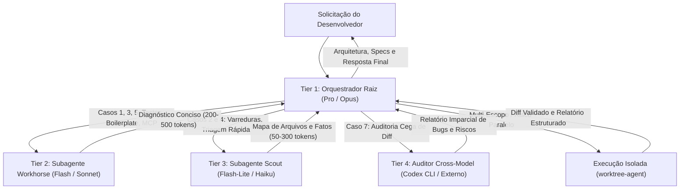

# Playbook do Smart Model Routing

**Blindagem do Contexto Raiz, Economia de Modelos em 4 Tiers e Orquestração Multi-Harness para Agentes de Engenharia**

---

## 1. O Problema: Poluição do Contexto Raiz e Degradação Quadrática de Tokens

A maioria dos desenvolvedores trata a conversa principal de um assistente de IA como um terminal comum: executa `pytest`, `npm run build`, `git diff`, buscas `grep` amplas e chamadas MCP/API verbosas diretamente na thread raiz.

Esse único hábito destrói simultaneamente a **precisão de raciocínio** e a **cota de tokens**, por causa de duas propriedades estruturais de sessões LLM autorregressivas:

### 1.1 Cada Turno Reenvia Todo o Histórico Acumulado

Harnesses de agentes LLM são *stateless* entre requisições HTTP. No turno $k$, o provedor precisa processar todas as instruções de sistema, mensagens do usuário, chamadas de ferramenta e **saídas de ferramentas** dos turnos $1 \dots k-1$.

Suponha que uma única execução ruidosa de suíte de testes ou um dump JSON de MCP injete **$T_{\text{ruído}} = 32.000$ tokens** no turno 4 de uma sessão de 20 turnos:

$$\text{Tokens Desperdiçados} = T_{\text{ruído}} \times (N - k + 1) = 32.000 \times 17 = 544.000 \text{ tokens}$$

Um único comando verboso no início da sessão não custa 32 mil tokens — ele custa **mais de meio milhão de tokens** reprocessados no modelo principal mais caro (`Pro` / `Opus`) até o fim da conversa.

### 1.2 Diluição de Atenção ("Lost in the Middle")

Mesmo em janelas de 200K–1M tokens, a qualidade prática cai muito antes do limite rígido:

- **Colapso Sinal/Ruído**: 30.000 tokens de linhas de testes aprovados, stack traces ou schemas OpenAPI afogam os 400 tokens de invariantes arquiteturais que realmente garantem a corretude.
- **Compactação Prematura**: Quando a janela raiz atinge o limiar de compactação, o harness resume turnos antigos e apaga assinaturas exatas de funções, casos de borda e restrições já alinhadas.
- **Esgotamento de Cota Flagship**: Queimar cota de raciocínio nobre (`Pro`, `Opus`, `GPT-5/6`) com `git status`, `grep` ou geração mecânica de DTOs deixa você sem cota justamente quando precisa de design arquitetural profundo.

---

## 2. A Solução: Arquitetura de Roteamento em 4 Tiers

O **Smart Model Routing** impõe a **Blindagem do Contexto Raiz (Root Context Shielding)**: o modelo flagship atua **estritamente como Arquiteto, Orquestrador e Interlocutor**, enquanto tarefas de alto I/O, mecânicas e de validação são isoladas em subagentes descartáveis ou CLIs externas cross-model.



### Os Quatro Tiers Explicados

| Tier | Papel | Modelos Típicos | O Que Roda Aqui | O Que Retorna ao Raiz |
| :--- | :--- | :--- | :--- | :--- |
| **Tier 1: Orquestrador** | Arquiteto e Interlocutor | `Pro`, `Opus`, Flagship Reasoning | Design de sistema, specs, trade-offs, decomposição de tarefas, síntese final | Decisões claras e planos concisos ao usuário |
| **Tier 2: Workhorse** | Construtor e Verificador | `Flash`, `Sonnet`, Balanced Coder | Suítes de teste, builds, linters, DTOs, mappers, migrations, absorção de JSON MCP | Status pass/fail, falhas exatas, lista de arquivos editados |
| **Tier 3: Scout** | Explorador e Triagem | `Flash-Lite`, `Haiku`, `Mini/Nano` | Varreduras somente-leitura, `git status`, leitura de configs, rastreio de símbolos | Caminhos de arquivos, mapa de chamadas, fatos únicos |
| **Tier 4: Cross-Auditor** | Revisor Cego | `Codex CLI`, Provedor Distinto | Code review pré-commit, auditoria de concorrência/segurança, segunda opinião | Lista imparcial de bugs e alertas de borda |

---

## 3. Economia de Tokens: Sessão Desprotegida vs. Contexto Blindado

Considere uma implementação realista de feature em 18 turnos envolvendo exploração de codebase, 4 arquivos de schema/serviço, 3 execuções de testes unitários, 1 passagem de linter, 1 consulta MCP ao tracker e uma revisão pré-commit:

| Operação | Sessão Raiz Desprotegida (Só Flagship) | Sessão Blindada (Smart Model Routing) | Economia no Raiz |
| :--- | :--- | :--- | :--- |
| Exploração do codebase (12 arquivos + grep) | ~28.000 tokens acumulados no raiz | ~450 tokens (mapa sintetizado pelo `Scout`) | **~98%** |
| Implementação mecânica e edições | ~18.000 tokens de diffs e leituras | ~600 tokens (contrato + caminhos alterados) | **~96%** |
| 3 rodadas de testes + 1 lint/typecheck | ~45.000 tokens de stdout/tracebacks brutos | ~500 tokens (linhas de falha e contagens) | **~99%** |
| Consulta MCP (tracker / Figma JSON) | ~22.000 tokens de payload JSON bruto | ~300 tokens (campos e IDs extraídos) | **~98%** |
| Triagens rápidas de git/ambiente (4x) | ~4.000 tokens de ruído de comando | ~150 tokens (fatos diretos do `Scout`) | **~96%** |
| **Pegada Acumulada no Contexto Raiz** | **~125.000+ tokens (dispara compactação)** | **~22.000–35.000 tokens (foco intacto)** | **~65%–80% global** |

> **Insight Central**: Subagentes consomem tokens baratos (`Flash`/`Haiku`) em suas próprias janelas efêmeras — e **descartam** 98% do ruído ao encerrar. O seu contexto flagship raiz permanece enxuto, afiado e livre de compactação do turno 1 ao turno 30.

---

## 4. Guia dos 7 Casos Operacionais com Prompts Reais

Abaixo está o guia completo dos 7 casos de uso com exemplos prontos para delegação.

### Caso 1: Validação Estática, Linting, Testes e Builds
- **Destino**: `Workhorse` (`self` com `flash` no Antigravity; `Task` com `haiku` no Claude Code; worker silencioso no Codex).
- **Por quê**: Runners de teste e compiladores emitem milhares de linhas de sucesso ou warnings de dependências. Isole completamente a tempestade de stdout/stderr.
- **Exemplo de Prompt de Delegação**:
  ```text
  Execute lint, type-check e testes unitários em `services/billing`:
  - Comandos: `ruff check . && mypy src && pytest -q --tb=short`
  - Se tudo passar, retorne apenas as contagens exatas e duração.
  - Se houver falha, inspecione o arquivo/teste que quebrou e retorne APENAS:
    (1) comando que falhou, (2) nome exato do teste/regra, (3) causa-raiz e (4) arquivo:linha.
  Não cole logs completos de testes aprovados.
  ```

### Caso 2: Exploração, Varredura e Pesquisa no Codebase
- **Destino**: `Scout` / `Research` (`research` com `flash` no Antigravity; `Task(subagent_type="Explore", model="haiku")` no Claude Code).
- **Por quê**: Entender uma feature frequentemente exige ler 10–25 arquivos. O orquestrador raiz precisa apenas do mapa arquitetural, não de cada bloco de imports.
- **Exemplo de Prompt de Delegação**:
  ```text
  Explore como tokens de autenticação são emitidos, renovados e revogados em `src/auth/` e `src/middleware/`.
  Retorne um mapa estruturado com:
  1. Entrypoints e hooks de middleware (arquivo:linha)
  2. Fluxo de ciclo de vida do token (emissão -> validação -> revogação)
  3. Dependências de armazenamento/cache e configuração de TTL
  4. Invariantes implícitas ou guardas de borda
  Limite o relatório a 400 palavras. Não modifique arquivos.
  ```

### Caso 3: Implementação Mecânica e Boilerplate
- **Destino**: `Workhorse` (`self` com `flash` no Antigravity; `Task(subagent_type="general-purpose", model="sonnet")` no Claude Code; `codex exec` no Codex).
- **Por quê**: Assim que o arquiteto raiz define o contrato de dados, assinaturas e invariantes, gerar DTOs, schemas Pydantic/Zod, mappers, migrations e testes unitários é execução determinística.
- **Exemplo de Prompt de Delegação**:
  ```text
  Implemente o schema `InvoiceWebhookPayload` e seu mapper conforme este contrato:
  - Arquivo 1: `src/schemas/webhook.py` — modelo Pydantic v2 com `event_id: UUID`, `amount_cents: int` (> 0), `occurred_at: datetime`.
  - Arquivo 2: `src/mappers/invoice.py` — função pura `to_domain_event(payload) -> BillingEvent`.
  - Arquivo 3: `tests/test_invoice_mapper.py` — cobrir mapeamento válido, rejeição de valor <= 0 e normalização UTC.
  Siga os padrões de `src/schemas/payment.py`. Rode `pytest tests/test_invoice_mapper.py -q` e reporte os resultados exatos.
  ```

### Caso 4: Triagens Rápidas e Checagens Pontuais
- **Destino**: `Scout` (`self` com `flash_lite` no Antigravity; `Task` com `haiku` no Claude Code).
- **Por quê**: Verificar `git status`, ler a versão em `package.json` / `pyproject.toml` ou checar um binário no ambiente nunca deve gastar turnos do modelo flagship.
- **Exemplo de Prompt de Delegação**:
  ```text
  Verifique `git status -sb`, o nome da branch atual e as versões de `python` e `pytest` no ambiente ativo. Retorne apenas um resumo de 3 linhas.
  ```

### Caso 5: Integrações MCP e Serviços Externos
- **Destino**: `Workhorse` (`self` com `flash` no Antigravity; `Task` com `haiku` no Claude Code).
- **Por quê**: Servidores MCP (trackers de tarefas, árvores do Figma, introspecção GraphQL, paginação REST) retornam payloads JSON de 15KB–100KB. Deixe o subagente filtrar e destilar os dados.
- **Exemplo de Prompt de Delegação**:
  ```text
  Consulte o MCP do tracker de tarefas buscando cards abertos de alta prioridade na sprint atual.
  Extraia APENAS uma tabela Markdown com: `ID | Título | Status | Repositório/Componente | Bloqueios`.
  Descarte metadados JSON brutos, schemas de campos customizados e descrições HTML extensas.
  ```

### Caso 6: Arquitetura, Planejamento e Decisões de Design
- **Destino**: **Orquestrador Raiz** (`Pro` / `Opus` / Flagship Reasoning).
- **Por quê**: É aqui que modelos de alto raciocínio brilham. Com uma janela limpa contendo apenas fatos sintetizados pelos Tiers 2–3, o orquestrador analisa trade-offs, fronteiras de segurança, modos de falha e alinha especificações com o usuário.

### Caso 7: Code Review Cego e Auditoria Cruzada de Diffs
- **Destino**: **CLI Externa Cross-Model** (`codex review` / `codex exec` ao orquestrar pelo Antigravity ou Claude Code; ou `agy` / Claude CLI ao orquestrar pelo Codex).
- **Por quê**: Um modelo revisando o código que ele mesmo acabou de escrever sofre de **viés de confirmação** — ele compartilha os mesmos pontos cegos que originaram o bug. Enviar o `git diff` bruto para uma família de modelos distinta (*Blind Cross-Model Review*) captura condições de corrida sutis, guardas ausentes e riscos de segurança antes do commit.
- **Padrão de Execução**:
  ```bash
  # Auditar mudanças ainda não commitadas na árvore de trabalho
  codex review --uncommitted

  # Ou rodar auditoria focada em segurança e edge cases no diff staged
  git diff --cached | codex exec "Revise este diff staged como um staff engineer sênior. Foque estritamente em bugs, race conditions, risco de perda de dados e guardas de borda ausentes. Ignore nitpicks de estilo."
  ```

---

## 5. Guardrails Complementares de Engenharia

O Smart Model Routing acompanha três guardrails complementares para garantir segurança operacional entre sessões e branches:

### 5.1 Isolamento via `worktree-agent` (`templates/agents/worktree-agent.pt-BR.md`)
Quando uma feature cruza múltiplos módulos ou envolve refatoração de risco, nunca altere o checkout principal diretamente. Delegue ao `worktree-agent` (`isolation: worktree`), que cria uma Git worktree isolada, implementa o contrato, roda validações silenciosas e devolve um **Relatório de Execução em Worktree** estruturado pronto para revisão ou merge.

### 5.2 Continuidade de Sessão (`templates/protocols/CONTEXT_HANDOFF.template.pt-BR.md`)
Mesmo com o contexto raiz blindado, sessões eventualmente terminam. Manter `docs/CONTEXT_HANDOFF.md` em cada repositório garante que toda nova sessão de IA restaure imediatamente:
- Decisões Arquiteturais (ADRs) consolidadas
- Serviços ativos, workers e versões
- Tarefas pendentes priorizadas com ponteiros de arquivo
- Bloqueios conhecidos e logs da última verificação

### 5.3 Trava de Segurança de Produção (`prod-deploy-safety`)
Agentes autônomos nunca devem publicar código sujo ou sem aprovação:
1. **Bloqueio de Árvore Suja**: Nunca faça merge, push para a `main` ou dispare builds/releases de produção se `git status` indicar arquivos modificados ou não rastreados.
2. **Portão Humano Explícito**: Sempre inspecione `git status` e obtenha **autorização explícita do usuário** imediatamente antes de mergear na `main`, fazer push para a `main` ou disparar releases de produção.
